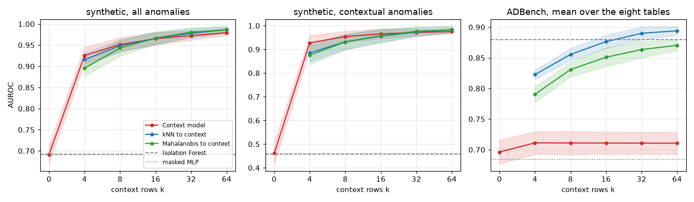
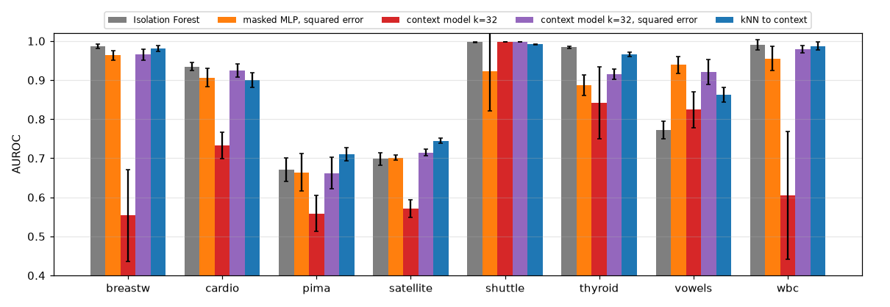

# contextad

When what counts as normal depends on the population a row comes from, does an anomaly detector that sees a context set (other rows of the same population) beat detectors that score rows in isolation, and does it keep working when the set of columns changes?

The study runs on a laptop CPU. It has a generator of synthetic populations with contextual anomalies, eight small ADBench tables, four scikit-learn baselines, a masked MLP that scores each row alone, and a small attention model (146,452 parameters) that also reads a context set: other rows of the same population. Every number below is copied from `results/` (`results/tables.md` holds all tables, built by `scripts/report.py` from the per-seed JSON files).

## Findings

- On synthetic populations (Gaussian mixtures whose anomalies are kept by a density rule, which suits density-based references), detectors that score rows in isolation reach an AUROC of 0.692 (Isolation Forest) and sit at or below chance on contextual anomalies (0.457 to 0.485). The context model with 32 context rows reaches 0.973 ± 0.011, and 0.926 ± 0.020 with 4 rows.
- The learned model is not what brings the gain. The Mahalanobis distance to the 32 context rows reaches 0.981 ± 0.011 and the kNN distance to them 0.978 ± 0.011. The context model is 0.008 ± 0.006 below the Mahalanobis distance (paired over seeds).
- Anomalies inside the context hurt the learned model more than the two references. With 20 % anomalies in the context it falls to 0.935 ± 0.018, against 0.971 ± 0.014 for kNN and 0.959 ± 0.019 for Mahalanobis.
- On the eight ADBench tables (one population each; rows with identical feature vectors stay on one side of every split; five splits each, so 40 table and split pairs), the context model with 32 rows, scored by the standardized prediction error, reaches a mean AUROC of 0.711. Against the same network without context rows (0.696) the paired difference is +0.015 (95 % bootstrap interval -0.001 to +0.040; above zero in 7 of 8 tables and 31 of 40 splits). Against the masked MLP with the same score (0.684) it is +0.027 (-0.017 to +0.083; 4 of 8 tables). Against the kNN distance to the context rows (0.893) it is -0.182 and against Isolation Forest (0.879) it is -0.169, each above zero in at most 2 of 8 tables.
- Exploratory: the squared-error score was added after a first, partial ADBench run in which the standardized score looked weak. With it the masked MLP reaches 0.867 and the context model 0.885. The context model is +0.018 above the masked MLP with that score (-0.001 to +0.042; 6 of 8 tables), -0.008 against the kNN distance to the context rows (-0.031 to +0.017; 3 of 8 tables) and +0.006 against Isolation Forest (-0.028 to +0.053; 3 of 8 tables). For the same context model the squared error is +0.174 above the standardized error (+0.086 to +0.278; 7 of 8 tables).
- With a random half of the columns the neural models need no retraining. On synthetic data the context model goes from 0.973 ± 0.011 to 0.925 ± 0.011, the kNN distance to the context from 0.978 ± 0.011 to 0.942 ± 0.014, and the label-informed oracle density from 0.9999 to 0.980 ± 0.005. The detectors that score rows in isolation go from about 0.69 to about 0.67.

## Results

### Synthetic populations

Eight held-out populations per seed, five seeds. Each cell is the mean ± standard deviation over seeds of the AUROC averaged over the eight populations (last column: AUPRC). "Contextual" and "ordinary" keep only that anomaly type next to all normal rows. The oracle is the true density of the row's population, which also defines the labels. It is a label-informed, near-perfect reference, not a guaranteed ceiling and not a competitor: its AUROC is 0.999877 to 0.999939 over the five seeds, which the table rounds to 1.000.

| method | AUROC | AUROC contextual | AUROC ordinary | AUPRC |
|---|---|---|---|---|
| Isolation Forest | 0.692 ± 0.021 | 0.457 ± 0.049 | 0.929 ± 0.020 | 0.342 ± 0.033 |
| Local Outlier Factor | 0.691 ± 0.020 | 0.463 ± 0.041 | 0.922 ± 0.023 | 0.345 ± 0.033 |
| kNN distance | 0.694 ± 0.021 | 0.467 ± 0.047 | 0.924 ± 0.021 | 0.350 ± 0.035 |
| PCA reconstruction error | 0.583 ± 0.039 | 0.485 ± 0.078 | 0.683 ± 0.026 | 0.197 ± 0.025 |
| Masked MLP, standardized error | 0.692 ± 0.027 | 0.460 ± 0.060 | 0.924 ± 0.018 | 0.322 ± 0.032 |
| Masked MLP, squared error | 0.695 ± 0.021 | 0.459 ± 0.049 | 0.932 ± 0.017 | 0.358 ± 0.032 |
| Context model without context (k=0) | 0.691 ± 0.022 | 0.461 ± 0.045 | 0.924 ± 0.014 | 0.289 ± 0.031 |
| Context model (k=32) | 0.973 ± 0.011 | 0.972 ± 0.014 | 0.974 ± 0.009 | 0.733 ± 0.092 |
| Context model, squared error (k=32) | 0.975 ± 0.009 | 0.969 ± 0.015 | 0.982 ± 0.004 | 0.773 ± 0.066 |
| kNN to the context rows (k=32) | 0.978 ± 0.011 | 0.973 ± 0.020 | 0.983 ± 0.003 | 0.755 ± 0.066 |
| Mahalanobis to the context rows (k=32) | 0.981 ± 0.011 | 0.976 ± 0.019 | 0.984 ± 0.005 | 0.810 ± 0.075 |
| Oracle density of the true population | 1.000 ± 0.000 | 1.000 ± 0.000 | 1.000 ± 0.000 | 0.998 ± 0.001 |

The first seven rows score each row alone; the scikit-learn detectors are fit on rows of the training populations. The same detectors fit instead on the rows of the eight test populations (the most favourable case for scoring rows in isolation, since they then know where the test populations sit, though not which population a row belongs to):

| method | AUROC | AUROC contextual | AUROC ordinary | AUPRC |
|---|---|---|---|---|
| Isolation Forest, fit on test populations | 0.707 ± 0.022 | 0.471 ± 0.041 | 0.943 ± 0.015 | 0.344 ± 0.033 |
| Local Outlier Factor, fit on test populations | 0.741 ± 0.010 | 0.485 ± 0.014 | 0.995 ± 0.002 | 0.486 ± 0.009 |
| kNN distance, fit on test populations | 0.750 ± 0.039 | 0.506 ± 0.070 | 0.996 ± 0.001 | 0.507 ± 0.025 |
| PCA reconstruction error, fit on test populations | 0.691 ± 0.032 | 0.518 ± 0.049 | 0.865 ± 0.017 | 0.300 ± 0.044 |

Differences taken per seed (same worlds, same contexts):

| difference in AUROC | all | contextual | ordinary |
|---|---|---|---|
| context model k=32 minus k=0 | 0.281 ± 0.022 | 0.511 ± 0.040 | 0.049 ± 0.019 |
| context model k=32 minus masked MLP | 0.281 ± 0.025 | 0.512 ± 0.055 | 0.049 ± 0.020 |
| context model k=32 minus Isolation Forest | 0.280 ± 0.020 | 0.515 ± 0.044 | 0.044 ± 0.023 |
| Mahalanobis to context minus context model k=32 | 0.008 ± 0.006 | 0.005 ± 0.009 | 0.011 ± 0.009 |

### Context size

One context model is trained with k drawn from {0, 4, 8, 16, 32, 64}. k=0 is the same network without context rows; the two references need at least a few rows. Left and middle: synthetic data. Right: mean over the eight ADBench tables. Bands are one standard deviation over seeds (splits for ADBench); dashed and dotted lines are Isolation Forest and the masked MLP, both without context.



| k | Context model | kNN to context | Mahalanobis to context | ADBench mean, context model |
|---|---|---|---|---|
| 0 | 0.691 ± 0.022 | n/a | n/a | 0.696 |
| 4 | 0.926 ± 0.020 | 0.916 ± 0.015 | 0.896 ± 0.019 | 0.711 |
| 8 | 0.951 ± 0.016 | 0.949 ± 0.014 | 0.943 ± 0.019 | 0.711 |
| 16 | 0.965 ± 0.015 | 0.966 ± 0.013 | 0.967 ± 0.015 | 0.711 |
| 32 | 0.973 ± 0.011 | 0.978 ± 0.011 | 0.981 ± 0.011 | 0.711 |
| 64 | 0.979 ± 0.005 | 0.986 ± 0.007 | 0.987 ± 0.008 | 0.711 |

### Anomalies in the context set

Every context row is an anomaly with the given probability (half contextual, half ordinary); the rows to score and the models are unchanged. The default pools hold 2 to 5 %.

| context anomalies | Context model | kNN to context | Mahalanobis to context |
|---|---|---|---|
| 0 % | 0.982 ± 0.008 | 0.980 ± 0.010 | 0.987 ± 0.010 |
| 5 % | 0.971 ± 0.010 | 0.977 ± 0.011 | 0.976 ± 0.013 |
| 10 % | 0.961 ± 0.012 | 0.976 ± 0.012 | 0.970 ± 0.016 |
| 20 % | 0.935 ± 0.018 | 0.971 ± 0.014 | 0.959 ± 0.019 |

### Training rows and loss

The training rows are unlabeled and contain anomalies. Without trimming the loss the context model learns to explain them, and falls from 0.973 ± 0.011 to 0.899 ± 0.024. Trained on rows without any anomaly it reaches 0.965 ± 0.017, close to the default.

| training rows and loss | context model k=32 | context model k=32, contextual only | context model k=0 | masked MLP |
|---|---|---|---|---|
| 2 to 5 % anomalies, trimmed loss (default) | 0.973 ± 0.011 | 0.972 ± 0.014 | 0.691 ± 0.022 | 0.692 ± 0.027 |
| 2 to 5 % anomalies, plain loss | 0.899 ± 0.024 | 0.933 ± 0.029 | 0.671 ± 0.024 | 0.651 ± 0.025 |
| no anomalies, plain loss | 0.965 ± 0.017 | 0.974 ± 0.017 | 0.692 ± 0.026 | 0.686 ± 0.025 |

### ADBench tables

Five stratified 70/30 splits per table, in which rows with the same value in every column stay on one side of the split (the test sets of the tables with repeated rows hold a few rows more or less than 30 %: breastw 179 to 203 rows instead of 205). Anomalies are the minority class of each table.

| table | rows | columns | anomalies |
|---|---|---|---|
| breastw | 683 | 9 | 35.0 % |
| cardio | 1,831 | 21 | 9.6 % |
| pima | 768 | 8 | 34.9 % |
| satellite | 6,435 | 36 | 31.6 % |
| shuttle | 49,097 | 9 | 7.2 % |
| thyroid | 3,772 | 6 | 2.5 % |
| vowels | 1,456 | 12 | 3.4 % |
| wbc | 223 | 9 | 4.5 % |

Four tables repeat feature vectors (third column below). A plain stratified split cuts such sets of rows across the split, so test rows get exact copies among the training rows and in the scored contexts. The table counts them for the plain split of the same five seeds (normal / anomalous test rows, summed over the five splits; `scripts/count_duplicates.py` writes `results/duplicates.csv`). The reported runs use the split that keeps identical rows together, where every count is zero. Identical rows carry the same label in every table (`mixed_label_vectors` is 0 in `results/duplicate_rows.csv`).

| table | rows | rows in a repeated vector | plain split: copy in the training rows | plain split: copy in a scored context | grouped split: any copy |
|---|---|---|---|---|---|
| breastw | 683 | 280 | 390 of 665 / 6 of 360 | 168 of 665 / 0 of 360 | 0 |
| cardio | 1,831 | 16 | 16 of 2,485 / 2 of 265 | 0 of 2,485 / 0 of 265 | 0 |
| pima | 768 | 0 | 0 of 750 / 0 of 405 | 0 of 750 / 0 of 405 | 0 |
| satellite | 6,435 | 0 | 0 of 6,600 / 0 of 3,055 | 0 of 6,600 / 0 of 3,055 | 0 |
| shuttle | 49,097 | 0 | 0 of 68,385 / 0 of 5,265 | 0 of 68,385 / 0 of 5,265 | 0 |
| thyroid | 3,772 | 163 | 211 of 5,520 / 0 of 140 | 4 of 5,520 / 0 of 140 | 0 |
| vowels | 1,456 | 8 | 0 of 2,110 / 10 of 75 | 0 of 2,110 / 1 of 75 | 0 |
| wbc | 223 | 0 | 0 of 320 / 0 of 15 | 0 of 320 / 0 of 15 | 0 |

Clipping the standardized columns at 8 standard deviations makes 17 of the 73,650 shuttle test rows equal to a training row, none of them in a scored context (the `clipped_` columns of `results/duplicates.csv`).

AUROC, mean ± standard deviation over the five splits; the last column is the mean over tables (AUPRC is in `results/adbench_auprc.csv`).

| method | breastw | cardio | pima | satellite | shuttle | thyroid | vowels | wbc | mean |
|---|---|---|---|---|---|---|---|---|---|
| Isolation Forest | 0.99 ± 0.01 | 0.93 ± 0.01 | 0.67 ± 0.03 | 0.70 ± 0.02 | 1.00 ± 0.00 | 0.98 ± 0.00 | 0.77 ± 0.02 | 0.99 ± 0.01 | 0.879 |
| LOF | 0.22 ± 0.08 | 0.57 ± 0.04 | 0.62 ± 0.02 | 0.56 ± 0.01 | 0.51 ± 0.02 | 0.67 ± 0.04 | 0.93 ± 0.01 | 0.93 ± 0.03 | 0.627 |
| kNN | 0.97 ± 0.01 | 0.69 ± 0.03 | 0.70 ± 0.03 | 0.66 ± 0.01 | 0.67 ± 0.01 | 0.96 ± 0.00 | 0.98 ± 0.00 | 0.99 ± 0.02 | 0.828 |
| PCA | 0.91 ± 0.03 | 0.75 ± 0.02 | 0.59 ± 0.03 | 0.65 ± 0.01 | 0.74 ± 0.05 | 0.94 ± 0.02 | 0.84 ± 0.04 | 0.96 ± 0.03 | 0.796 |
| Masked MLP, standardized error | 0.52 ± 0.08 | 0.76 ± 0.04 | 0.59 ± 0.05 | 0.59 ± 0.01 | 0.84 ± 0.22 | 0.76 ± 0.05 | 0.85 ± 0.04 | 0.56 ± 0.15 | 0.684 |
| Masked MLP, squared error | 0.96 ± 0.01 | 0.91 ± 0.02 | 0.66 ± 0.05 | 0.70 ± 0.01 | 0.92 ± 0.10 | 0.89 ± 0.03 | 0.94 ± 0.02 | 0.96 ± 0.03 | 0.867 |
| Context model k=0 | 0.53 ± 0.10 | 0.73 ± 0.04 | 0.56 ± 0.05 | 0.57 ± 0.02 | 1.00 ± 0.00 | 0.84 ± 0.09 | 0.83 ± 0.04 | 0.52 ± 0.21 | 0.696 |
| Context model k=32 | 0.55 ± 0.12 | 0.73 ± 0.03 | 0.56 ± 0.05 | 0.57 ± 0.02 | 1.00 ± 0.00 | 0.84 ± 0.09 | 0.82 ± 0.05 | 0.61 ± 0.16 | 0.711 |
| Context model k=32, squared error | 0.97 ± 0.01 | 0.92 ± 0.02 | 0.66 ± 0.04 | 0.71 ± 0.01 | 1.00 ± 0.00 | 0.92 ± 0.01 | 0.92 ± 0.03 | 0.98 ± 0.01 | 0.885 |
| kNN to context | 0.98 ± 0.01 | 0.90 ± 0.02 | 0.71 ± 0.02 | 0.75 ± 0.01 | 0.99 ± 0.00 | 0.97 ± 0.01 | 0.86 ± 0.02 | 0.99 ± 0.01 | 0.893 |
| Mahalanobis to context | 0.97 ± 0.01 | 0.89 ± 0.02 | 0.66 ± 0.02 | 0.64 ± 0.01 | 0.98 ± 0.00 | 0.95 ± 0.01 | 0.84 ± 0.04 | 0.97 ± 0.02 | 0.864 |



Paired differences in AUROC over the 8 tables and 5 splits (40 pairs). The mean is the mean over tables of the mean over splits. The interval resamples the tables with replacement, then the splits inside each drawn table (10,000 resamples, seed 0, `scripts/report.py`). The squared-error rows are exploratory: that score was added after a first, partial run.

| paired difference in AUROC | mean | 95 % interval | tables above 0 | splits above 0 |
|---|---|---|---|---|
| standardized error: context k=32 minus k=0 | +0.015 | [-0.001, +0.040] | 7 of 8 | 31 of 40 |
| standardized error: context k=32 minus masked MLP | +0.027 | [-0.017, +0.083] | 4 of 8 | 17 of 40 |
| standardized error: context k=32 minus kNN to context | -0.182 | [-0.287, -0.088] | 1 of 8 | 6 of 40 |
| standardized error: context k=32 minus Isolation Forest | -0.169 | [-0.288, -0.063] | 2 of 8 | 7 of 40 |
| squared error: context k=32 minus masked MLP | +0.018 | [-0.001, +0.042] | 6 of 8 | 30 of 40 |
| squared error: context k=32 minus kNN to context | -0.008 | [-0.031, +0.017] | 3 of 8 | 16 of 40 |
| squared error: context k=32 minus Isolation Forest | +0.006 | [-0.028, +0.053] | 3 of 8 | 19 of 40 |
| context k=32: squared minus standardized error | +0.174 | [+0.086, +0.278] | 7 of 8 | 36 of 40 |

### Schema change

At test time a random half of the columns is kept (5 of 10 on synthetic data, about half on the tables), three random subsets per seed. The neural models are not retrained: they were trained with random column masks and score the kept columns, and the context rows lose the same columns. The scikit-learn detectors and the two references are fit again on the kept columns. ADBench columns are means over tables.

| method | synthetic, all columns | synthetic, half | ADBench, all | ADBench, half |
|---|---|---|---|---|
| Isolation Forest | 0.692 ± 0.021 | 0.671 ± 0.012 | 0.879 | 0.846 |
| Local Outlier Factor | 0.691 ± 0.020 | 0.667 ± 0.012 | 0.627 | 0.650 |
| kNN distance | 0.694 ± 0.021 | 0.666 ± 0.013 | 0.828 | 0.805 |
| PCA reconstruction error | 0.583 ± 0.039 | 0.596 ± 0.022 | 0.796 | 0.686 |
| Masked MLP, standardized error | 0.692 ± 0.027 | 0.671 ± 0.015 | 0.684 | 0.735 |
| Masked MLP, squared error | 0.695 ± 0.021 | 0.671 ± 0.014 | 0.867 | 0.832 |
| Context model without context (k=0) | 0.691 ± 0.022 | 0.670 ± 0.014 | 0.696 | 0.720 |
| Context model (k=32) | 0.973 ± 0.011 | 0.925 ± 0.011 | 0.711 | 0.730 |
| Context model, squared error (k=32) | 0.975 ± 0.009 | 0.926 ± 0.010 | 0.885 | 0.841 |
| kNN to the context rows (k=32) | 0.978 ± 0.011 | 0.942 ± 0.014 | 0.893 | 0.858 |
| Mahalanobis to the context rows (k=32) | 0.981 ± 0.011 | 0.935 ± 0.016 | 0.864 | 0.825 |
| Oracle density of the true population | 1.000 ± 0.000 | 0.980 ± 0.005 | n/a | n/a |

### Cost

Two threads per job on a shared 10-core laptop (load average between 4 and 103 during the runs, so timings are rough). The ADBench row averages 40 runs, and the four tables with repeated rows were re-run later at a lower load than the other four (`load_end` and `seconds` in each JSON file).

| run | context model s | masked MLP s | parameters (context, MLP) |
|---|---|---|---|
| synthetic, one seed | 147 | 99 | 146,452, 142,100 |
| ADBench, both models, one table | 92 |  |  |

## What is in the repo

```
src/contextad/
  synthetic.py   populations (low-rank plus diagonal mixtures), contextual and ordinary anomalies
  models.py      MaskedMLP, ContextNet (attention over a context set), trimmed Gaussian loss
  training.py    self-supervised loops, fresh populations every 250 steps, validation stopping
  masking.py     column masks and groups of columns hidden together
  scoring.py     prediction-error scores, context sampling, blocks of rows
  detectors.py   scikit-learn baselines, kNN and Mahalanobis to the context, oracle density
  evaluate.py    per-population metrics; metrics.py has AUROC and AUPRC
  adbench.py     table loading, stratified splits that keep identical rows together, standardization
  report.py      table builders behind scripts/report.py
scripts/
  download_adbench.sh   fetch the eight tables (pinned commit, SHA-256 checked)
  run_synthetic.py      one seed of the synthetic study
  run_adbench.py        one table and one split
  count_duplicates.py   test rows with an exact copy in the training rows or a context
  count_validation.py   validation rows of every run, with and without the minimum of 16
  report.py, figures.py tables and figures from results/
tests/                  123 tests, about a minute on a laptop CPU
results/                per-seed JSON, CSV tables, tables.md, two figures
```

## Reproduce

No GPU is used; on Colab, run the same commands on a CPU runtime.

```
pip install torch --index-url https://download.pytorch.org/whl/cpu
pip install -e ".[dev,plots]"
sh scripts/download_adbench.sh
for s in 0 1 2 3 4; do python scripts/run_synthetic.py --seed $s; done
for d in cardio thyroid satellite shuttle pima wbc vowels breastw; do
  for s in 0 1 2 3 4; do python scripts/run_adbench.py --dataset $d --seed $s; done
done
python scripts/count_duplicates.py
python scripts/count_validation.py
for s in 0 1 2 3 4; do
  python scripts/run_synthetic.py --seed $s --trim 0 --main-only --out results/ablation_plain
  python scripts/run_synthetic.py --seed $s --trim 0 --clean-train --main-only --out results/ablation_clean
done
python scripts/report.py && python scripts/figures.py
pytest -q
```

A synthetic seed takes about five minutes and an ADBench split between half a minute and five minutes, depending on the table and the load of the machine (`seconds` in each JSON file). Two runs of the synthetic script for seeds 0 to 3 gave identical AUROC values for every method they share.

## Method notes

- Populations. Ten columns. A population is a mixture of 1 to 3 Gaussians; the covariance of a component is rank 2 or 3 plus a diagonal of 0.05 to 0.3, with unit variance per column from the low-rank part. Component means are a population centre $\mathcal{N}(0, I)$ plus an offset $\mathcal{N}(0, 0.7^2 I)$. Each population has its own anomaly rate drawn from 2 to 5 %.
- Anomalies. Half are contextual: a row drawn from another population of the same world, kept only if its density under its own population is below the 2 % quantile of that population's rows and above the 5 % quantile under the source population. Half are ordinary: a row of the own population with deviations multiplied by 3, kept only if it is below the 2 % quantile of every population of the world.
- Splits. Per seed, the test world has 8 populations never seen in training. Each has 2000 rows to score and a separate pool of 512 rows with the same anomaly process, from which context sets are drawn. Training uses a fresh world of 256 populations with 128 rows each every 250 steps (3000 steps). The scikit-learn detectors are fit once on the first of these banks (at most 10,000 rows).
- Metric. AUROC and AUPRC per held-out population, averaged over the populations. The AUROC over all rows pooled is stored in the JSON files.
- Models. The masked MLP has three layers of 256 units. ContextNet embeds each context row with its column mask, applies two self-attention blocks without positions (width 64, 4 heads), then two cross-attention blocks from the target row to the context; both models output a mean and a log variance for every column. The loss is the Gaussian negative log likelihood of the hidden columns, $\tfrac12(\log\sigma_j^2 + (x_j-\mu_j)^2/\sigma_j^2)$, where the 10 % of target rows with the highest loss are left out of each batch. Every episode keeps all columns half of the time, otherwise a random 30 to 90 % of them; each target row hides 1 to half of the available columns. One ContextNet is trained with k drawn from {0, 4, 8, 16, 32, 64}. AdamW, learning rate 2e-3 with 100 warm-up steps and a cosine decay, gradient clipping at 1.
- Score. Every available column is hidden in turn (in 12 groups when there are more than 12 columns) and predicted from the others and the context: $\mathrm{score}(x) = \frac{1}{|A|}\sum_{j\in A}(x_j-\mu_j)^2/\sigma_j^2$ over the available columns $A$. The squared-error variant drops $\sigma_j^2$.
- Contexts. A block of 50 consecutive test rows shares one context of k rows from the pool, and the scored row is never in its context. One draw per block, no averaging over draws.
- Baselines. Isolation Forest with 200 trees, LOF with 20 neighbours, mean distance to the 5 nearest rows, PCA reconstruction error with the components that explain 90 % of the variance (at most d minus 1). References: mean distance to the 5 nearest context rows, and the squared Mahalanobis distance under the Ledoit-Wolf covariance of the context rows. Oracle: minus the log density of the row under its true population.
- ADBench. Stratified 70/30 splits with seeds 0 to 4. Rows with the same value in every column stay on one side of a split: a set of identical rows that the stratified draw cut goes to the side of its first row, so no test row has an exact copy among the training rows or in a context. Tables without repeated rows split as the plain draw does. Columns are standardized with the training mean and standard deviation and clipped to ±8. The neural models train for 2000 steps on about 90 % of the training rows and keep the weights of the step with the lowest trimmed loss on the rest (at least 16 rows; no labels; the same rule keeps identical rows on one side of that cut). The scikit-learn detectors use all training rows. Contexts are random training rows, anomalies included.
- Choices made before the evaluated runs. The number of steps, the trimmed share, the size of the population bank and its refresh were set on one development world (seed 100, using its anomaly labels). No setting was tuned on the evaluated seeds or on ADBench labels. The squared-error rows were added after a first, partial ADBench run in which the standardized score looked weak, so they are exploratory; both scores are reported and the models were not changed.

## Limits

- The synthetic populations are Gaussian mixtures with a known low-rank structure, and the two context references fit that structure. The gap between the learned model and the references says nothing about real populations. The oracle reaches 0.9999 because it uses the density that also defines the anomalies: a near-perfect reference in this generator, not a bound for other data.
- The eight tables are small, have one population each, and are run with one fixed setting and five random splits. The trimmed share of 10 % is below the anomaly share of breastw, pima and satellite (31 to 35 %). LOF is below chance on breastw (0.22 ± 0.08), and I did not test why. These results are no claim about large benchmarks.
- The training rows are unlabeled but not clean, and the context model needs the trimmed loss to cope (training rows and loss table). The standardized-error score is much weaker than the squared error on the tables (0.711 against 0.885); I did not test why.
- The context pools carry anomalies at each population's own rate, one context is drawn per block of 50 rows, and contamination was tested on synthetic data only. No latent-prediction variant was built.
- Only exact copies are kept together: rows that differ in a rounding digit can still sit on both sides of a split.
- Timings come from a shared laptop with a changing load.

## License

Apache-2.0, see `LICENSE`.
